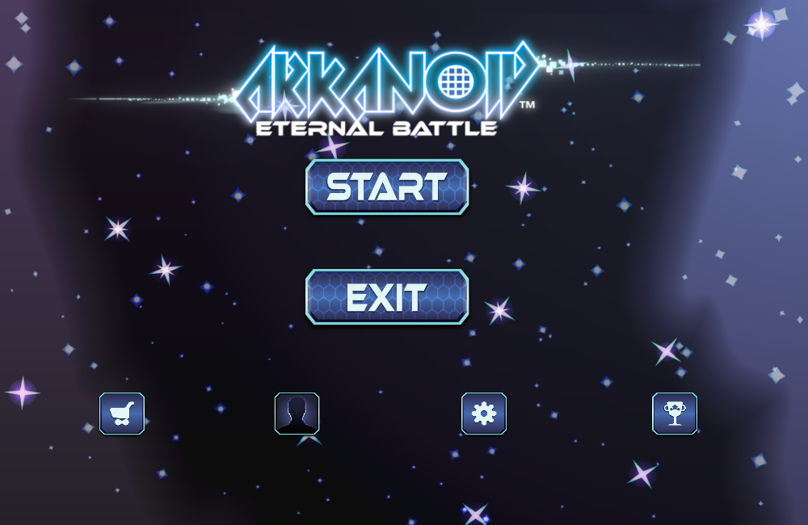
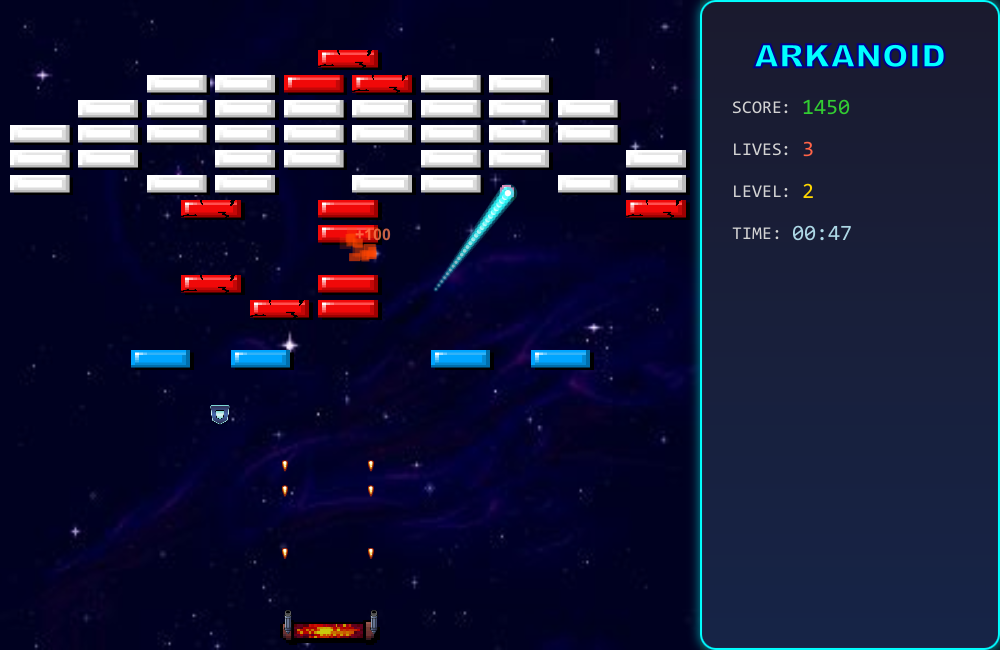
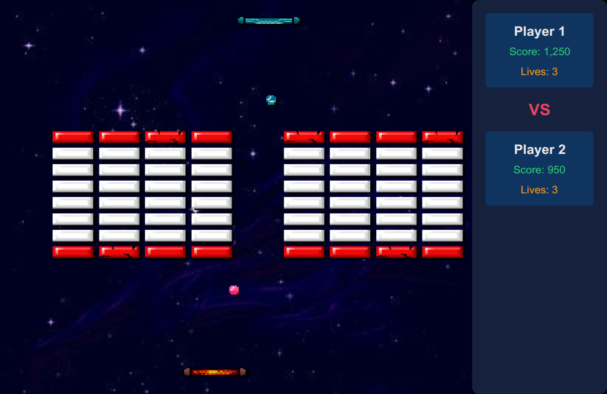
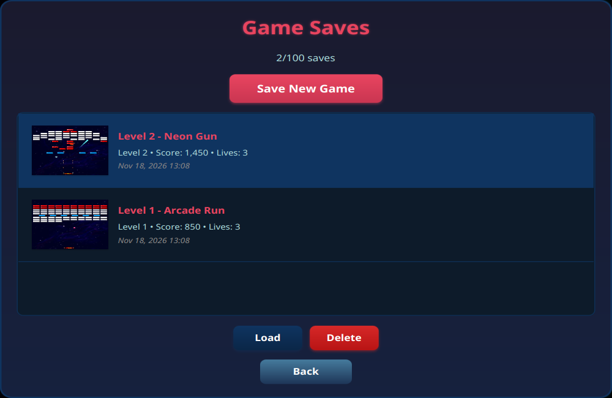
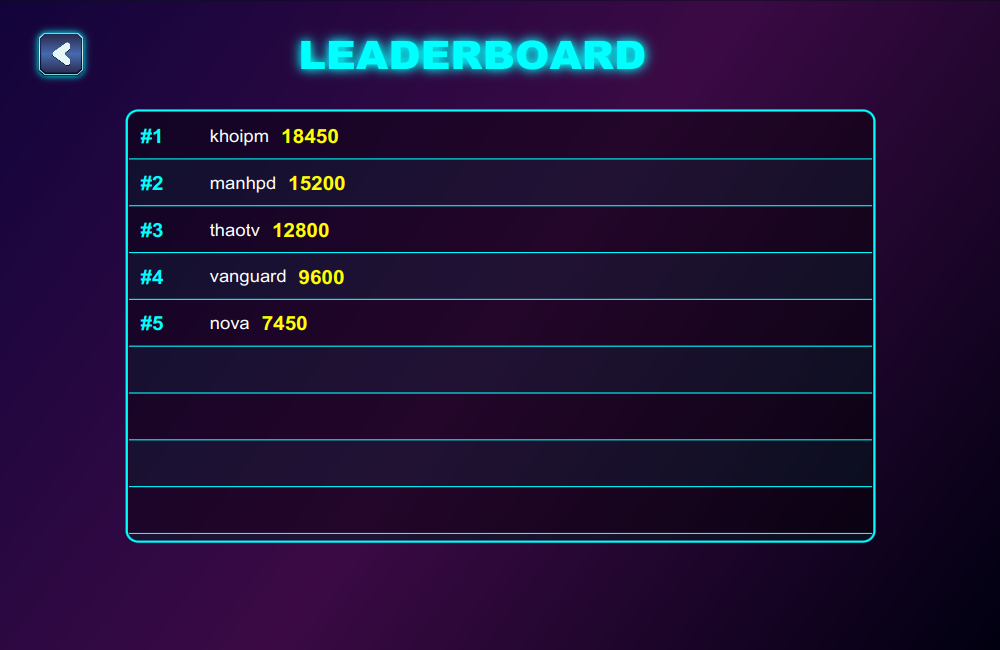
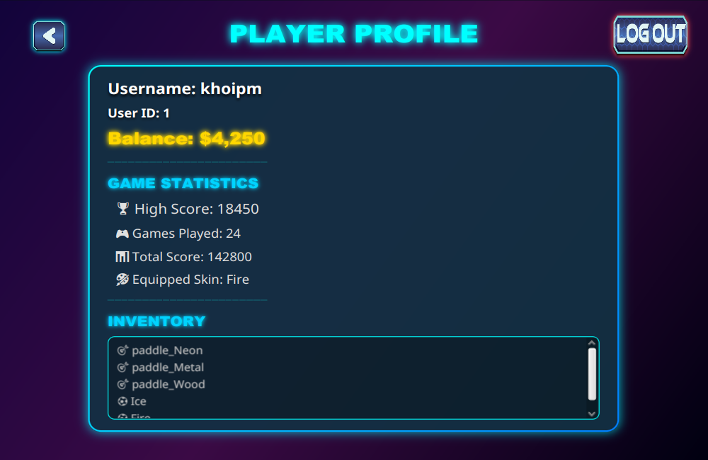

# Arkanoid

A desktop Arkanoid arcade game built with Java 21 and JavaFX 21 featuring single-player level progression, local two-player competitive play, LZ4-compressed save slots with canvas thumbnails, and SQLite-backed player profiles and skin customization. All screens render inside a persistent aspect-aligned viewport driven by a deterministic 120 Hz sub-stepped physics loop and object-pooled visual effects.

**Course:** Group 18 — Class 2526I_INT2204_6  
**Instructor:** Kiều Văn Tuyên  
**Semester:** Semester 1 (2025–2026)  

**Authors:**
1. Phạm Minh Khởi — 24020186
2. Trần Văn Thạo — 24020312
3. Phạm Đức Mạnh — 24020222

## Screenshots

| | |
| :---: | :---: |
| <br>Main Menu | <br>Single-Player Gameplay |
| <br>Two-Player Versus | <br>Save & Load System |
| <br>Leaderboard | <br>Player Profile |

## Features

- **Single-Player Campaign:** Three JSON-configured levels (`level1.json`–`level3.json`) with live score, lives, level, and elapsed-time HUD (`GameHudPanel`), plus a pause overlay (`GamePauseOverlay`) for resuming, saving, restarting, or returning to menu.
- **Two-Player Versus Mode:** Head-to-head local match (`TwoPlayerGameScreen` and `level_multiplayer.json`) supporting paddle-vs-ball bounds, ball-ball elastic collisions, opponent paddle hits, and a live `TwoPlayerStatsPanel`.
- **Bricks & Power-Ups:** Four brick types (`Normal`, `Strong`, `Moving`, `Unbreakable`) and five power-ups (`Expand Paddle`, `Multi-Ball`, `Gun Paddle`, `Explosive Ball`, `Row Clear`).
- **LZ4 Save & Load System:** Asynchronous save/load slots (`GameSaveManagerImpl`) storing LZ4-compressed JSON game state and captured `Canvas` PNG thumbnails in SQLite, plus `F5` quick-save while paused.
- **Accounts, Shop & Leaderboard:** SQLite WAL-backed user registration and login (`PasswordHasher`), persistent sessions, player profile stats, global high-score leaderboard, and ball/paddle skin shop (`Fire`, `Ice`, `Rainbow`, `Wood`, `Metal`, `Neon`).
- **Viewport & Performance:** Unified scalable viewport (`ViewportScaler`) inside a single persistent `Scene`, deterministic 120 Hz max physics sub-stepping (`1/120 s`), bounded `ObjectPool` reuse for bullets, particles, trails, and floating text, `ColorCache`, and background `MemoryMonitor`.

### Brick Types & Power-Ups

- **Bricks:** `Normal` (1 hit), `Strong` (3 hits with progressive crack textures), `Moving` (horizontal oscillation), and `Unbreakable` (immune to standard hits).

| Power-Up | Effect |
| :--- | :--- |
| `Expand Paddle` | Temporarily widens the paddle for easier ball catches |
| `Multi-Ball` | Spawns two additional balls in flight |
| `Gun Paddle` | Fires dual upward bullets from the paddle |
| `Explosive Ball` | Triggers an area-of-effect brick explosion on next impact |
| `Row Clear` | Clears all breakable bricks along a row or column |

## Architecture

- `com.arkanoid.core` — `GameConstants`, game entities (`Ball`, `Paddle`, `Brick`, `PowerUp`, `Bullet`, visual effects), and `CollisionDetector`.
- `com.arkanoid.systems` — `GameManager`, `LevelManager`, input handlers, `SoundManager`, `LoggingManager`, `ThreadManager`, LZ4 save/load (`systems.save`), and two-player services (`systems.twoplayer`).
- `com.arkanoid.ui` — Persistent `SceneManager`, `ViewportScaler`, `GameScene`, `GameHudPanel`, `GamePauseOverlay`, and FXML controllers (`ui.view`).
- `com.arkanoid.database` — SQLite WAL connection pool (`DatabaseManager`), repositories (`database.repository`), and user/profile/inventory/session managers.
- `com.arkanoid.utils` — `ObjectPool`, `ColorCache`, `ImageLoader`, `CompressionUtil`, `PasswordHasher`, and `CommandLineArgs`.
- `com.arkanoid.debug` — Background `MemoryMonitor` for heap and entity-pool diagnostics.

UML diagrams (`architecture.png`, `architecture.puml`, `architecture.md`) are available in [docs/uml/](docs/uml/).

## Build & Run

Requires **JDK 21**. The Gradle wrapper automatically resolves Gradle 9.1.0 and JavaFX 21.0.9 dependencies; player profiles and save slots are stored locally in `data/arkanoid.db`.

```bash
# Build and launch the game
bash ./gradlew run

# Launch with debug logging and in-game FPS/frame-time HUD
bash ./gradlew run --args="--log-level=DEBUG"

# Run the unit test suite
bash ./gradlew test
```

## Controls

| Mode | Input | Action |
| :--- | :--- | :--- |
| Single-Player | `Left` / `Right` | Move paddle |
| Single-Player | `SPACE` | Launch ball |
| Single-Player | `ESC` / `P` | Pause / resume game |
| Single-Player | `F5` | Quick-save (while paused) |
| Single-Player | `F3` / `F4` | Decrease / increase log verbosity |
| Two-Player | `A` / `D` | Move Player 1 paddle |
| Two-Player | `Left` / `Right` | Move Player 2 paddle |
| Two-Player | `SPACE` | Launch balls |
| Two-Player | `ESC` / `P` | Pause / resume match |

## Tech Stack

| Component | Version | Purpose |
| :--- | :--- | :--- |
| Java | 21 | Language & runtime |
| JavaFX | 21.0.9 | Desktop UI, FXML, Canvas, Media |
| Gradle | 9.1.0 | Build & dependency management |
| SQLite JDBC | 3.51.0.0 | Local WAL database storage |
| LZ4 (`lz4-java`) | 1.8.0 | Save-state & session compression |
| Gson | 2.13.2 | Level & save-state JSON serialization |
| Logback | 1.5.21 | Structured console & file logging |
| JUnit Jupiter | 5.10.2 | Unit testing |

## License

This project is licensed under the MIT License. See [LICENSE](LICENSE) for details.
